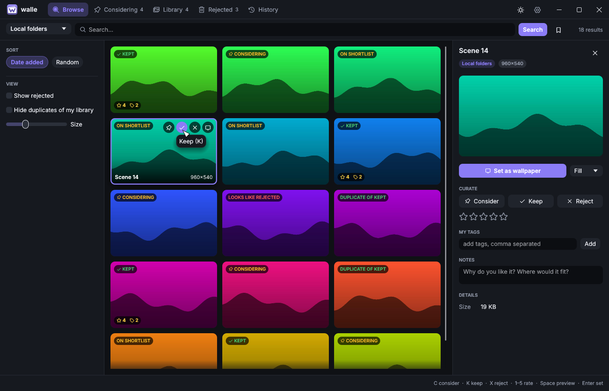
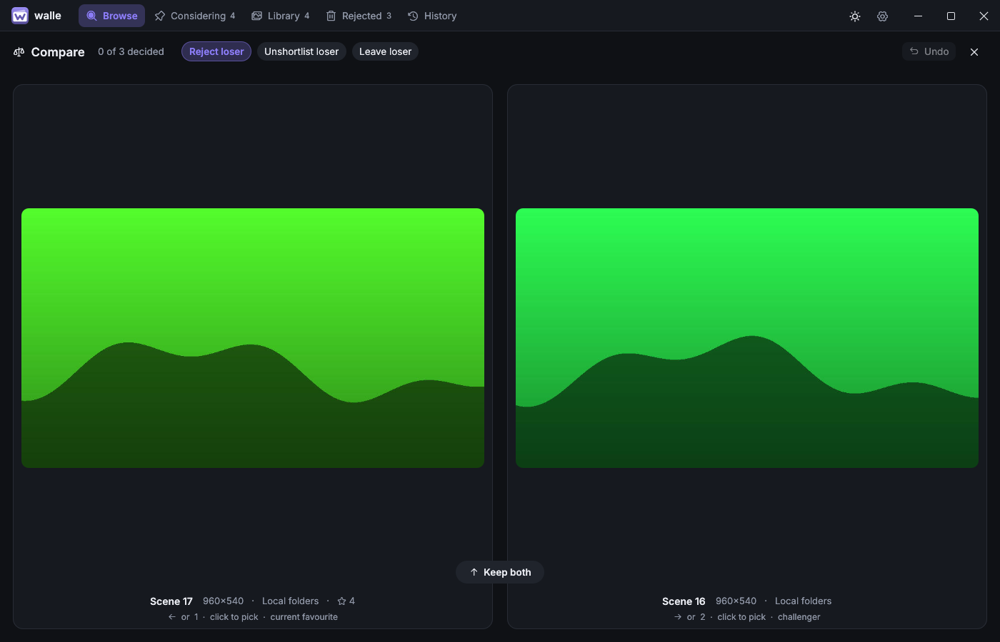
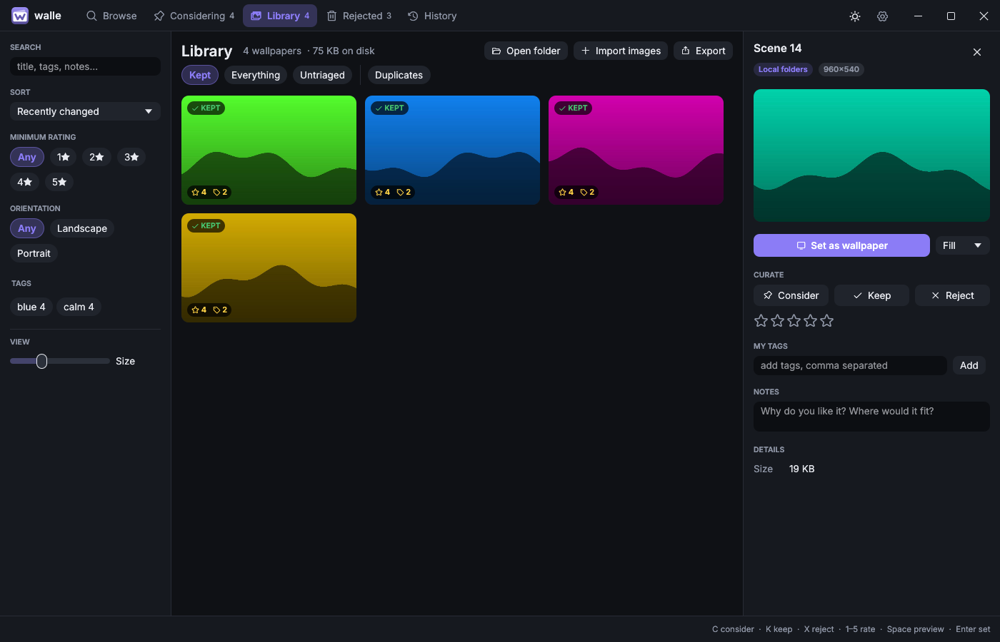

#  walle

**Browse, shortlist, compare, keep and set wallpapers.** A fast, keyboard-driven desktop app for Windows and Linux, written in Rust with [egui](https://github.com/emilk/egui).

[Website](https://ulaas.github.io/walle/) · [Download](https://github.com/ulaas/walle/releases/latest) · [Shortcuts](#shortcuts)



> walle was developed fully with AI, with a hint of human taste.

## What it does

Most wallpaper tools stop at "search and set". walle is built around the part in between: deciding.

* **Browse** nine sources in one window, with the filters each source really supports.
* **Consider** what catches your eye. It goes on a shortlist instead of into a pile of tabs.
* **Compare** the shortlist two at a time. The winner stays on and faces the next one.
* **Keep** the ones you like. They are downloaded at once, so your library works offline, with ratings, tags and notes.
* **Reject** the rest, and never see them again in any search.
* **Set** a wallpaper with `Enter`, or let rotation change it for you.

Everything is local: a SQLite library, a cache on disk and one config file. There is no account and no telemetry.

| Compare | Library |
|---|---|
|  |  |

## Sources

| Source | Key | Notes |
|---|---|---|
| Wallhaven | optional | Full search, tags, colours, toplists, "find similar". Key enables NSFW. |
| Unsplash | free access key | Curated "Wallpapers" topic by default. Photographers are credited, and downloads are reported as Unsplash requires. |
| Pexels | free key | Curated feed by default |
| Pixabay | free key | Images are at most 1280 px unless your key has full API access |
| Bing Daily | — | Last ~15 days in UHD |
| NASA APOD | — | The whole archive back to 1995, from science.nasa.gov. Selecting a picture loads its credit and explanation. |
| Openverse | — | Openly licensed images. Off by default because the API can be slow. |
| Lorem Picsum | — | Photos from Unsplash photographers |
| Local folders | — | Your own folders. Add them in Settings or drop a folder on the window. |

walle is not affiliated with any of these services. The pictures belong to their authors, and each service's terms apply to what you download from it.

## Install

Download the latest build from the [releases page](https://github.com/ulaas/walle/releases/latest):

| System | File | How |
|---|---|---|
| Windows | `walle-<version>-windows-x64.msi` | Installer: Program Files and a Start menu entry. A newer one replaces the older. |
| Windows | `walle-<version>-windows-x64.zip` | No installer: unpack it anywhere and run `walle.exe`. |
| Fedora, openSUSE | `walle-<version>-linux-x64.rpm` | `sudo dnf install ./walle-*.rpm` |
| Debian, Ubuntu 24.04 or newer | `walle-<version>-linux-x64.deb` | `sudo apt install ./walle-*.deb` |
| Any Linux | `walle-<version>-linux-x64.tar.gz` | Unpack it and run `./walle`. |

The Windows files are not code-signed, so SmartScreen may ask before the first start. On Linux walle needs the usual X11 or Wayland, `libxkbcommon` and GL libraries, which a desktop system already has.

Each release comes with `SHA256SUMS.txt` to check the download against.

## Build from source

You need a current stable [Rust toolchain](https://rustup.rs).

```sh
git clone https://github.com/ulaas/walle.git
cd walle
cargo run --release
```

On Linux you need the usual egui system libraries (X11/Wayland, `libxkbcommon`, GL).

## API keys

Set API keys in **Settings > Sources**, then press *Save changes* (`Ctrl+S`) at the top of the page. They take effect at once, without a restart. Leaving the page or closing the window saves as well; *Revert* undoes unsaved edits. Keys are saved to the user config file, on your machine only:

* Windows: `%APPDATA%\walle\config\config.toml`
* Linux: `~/.config/walle/config.toml`

You can also use an environment variable such as `WALLHAVEN_API_KEY`, `UNSPLASH_API_KEY`, `PEXELS_API_KEY` or `PIXABAY_API_KEY`.

## Shortcuts

| Input | Action |
|---|---|
| Arrow keys | move selection (←/→ also in the full-size preview) |
| `Space` / double-click | full-size preview (scroll to zoom, drag to pan, double-click toggles zoom) |
| `C` / `K` / `X` | consider / keep / reject (press again to clear) |
| `1`–`5`, `0` | rate / clear rating |
| `Enter` | set as wallpaper |
| `D` | download |
| Ctrl+click, Shift+click, Ctrl+A | multi-select (a bulk action bar appears) |
| `Esc` | close preview / clear selection |
| `F1` | About box: version, commit and shortcuts |

Hovering a card shows quick actions: consider, keep, reject and set wallpaper. Right-click a card for more.

## Views

* **Browse** searches the selected source. Wallpapers you rejected stay hidden.
* **Considering** is your shortlist.
* **Library** shows what you kept. Kept wallpapers are downloaded right away, so they work offline. You can filter by text (including your tags), tag, rating, orientation and source, and sort by date, rating or resolution. Export writes a JSON backup. Import it from Settings or drop the file on the window.
* **Compare**: in Considering, *Compare all* (or select a few and press *Compare*) shows two wallpapers side by side. Pick the better one with ←/→ or a click. The winner stays on and faces the next one. ↑ keeps both, and Backspace undoes. You choose what happens to the loser: reject it, take it off the shortlist, or leave it. At the end you can keep the finalists or set the winner as your wallpaper.
* **History** lists wallpapers you have set. The card of the current desktop wallpaper is marked *ON DESKTOP*.
* **Duplicates**: walle recognises the same picture across searches and sources from its thumbnail. Results that match something in your library get a badge. *Hide duplicates of my library* filters them out. Library > *Duplicates* groups near-identical wallpapers you have collected.
* **Wallhaven collections**: set your Wallhaven username in Settings (plus your API key for private collections). Collections then appear in the Browse sidebar. *Import all* keeps a whole collection and tags it with the collection's name.
* **Drag and drop or file pickers**: add images to the library, add a folder as a local source, or restore an export.

## Window

walle draws its own titlebar. Drag its empty space to move the window and double-click it to maximize. Right-click it for the window menu. Click the logo, or press `F1`, to open the About box, which shows the version and the commit the build came from.

## Rotation and background

Settings > *Rotation* changes the wallpaper automatically on an interval. It can pick from your kept wallpapers, the shortlist, a tag, a saved search or an online source. You can limit it to landscape images or a minimum rating, and it doesn't repeat recent picks.

* **Tray**: closing the window keeps walle in the tray. The tray menu has *Open*, *Next wallpaper*, *Rotate automatically*, *About* and *Quit*.
  * **Windows**: the window is hidden.
  * **Linux**: walle offers a StatusNotifierItem, which the panels of gevrek, KDE Plasma and others show (GNOME needs the AppIndicator extension). Wayland cannot hide a window, so walle closes it for good and goes on without one: only the tray icon, rotation and the night effect stay loaded. *Open* brings the window back. Where no panel shows tray icons, closing the window quits as before.
* **Start on login**: *Start walle when I sign in* launches walle with `--minimized` (on Linux: in the tray, without a window). Starting walle a second time brings the running instance to the front.

## Displays and effects

* **Desktops**: Windows, and on Linux GNOME, KDE Plasma, Cinnamon, MATE, XFCE, LXQt, Sway, Hyprland and gevrek, with `feh` as the fallback. You can also give walle your own command in Settings.
* **gevrek**: in a gevrek session walle is found by itself and sets the wallpaper through gevrek's own command (`gevrek wallpaper`, or the whole configuration with older versions). gevrek has a wallpaper per display, so walle offers each display by name: right-click a wallpaper for *Set on DP-2 only*, or use *Only on* in its details. *Set as wallpaper* sets all displays at once. With the *Span* fit mode one picture goes across all displays, each showing its part. Rotation can give every display a different wallpaper (Settings > *Rotation*). Cards show which display a wallpaper is on.
* **Effects** (Settings > *Wallpaper*): blur, dim, saturation, tint and vignette. walle renders them into a copy of the picture, sized for the display, and hands the copy to the desktop; the original is never changed. Saving the settings applies them to what is on the desktop now. They work on every desktop walle can set a wallpaper on.
* **At night**: *Dimmer and warmer at night* comes in over an hour and goes out over an hour. walle re-renders the wallpaper as it does, so it only moves while walle runs (the tray is enough).
* When walle is not running, the last pictures it rendered stay on the desktop. When it starts again it takes over from there: it knows what it put on which display, and leaves alone what someone else changed in the meantime.

## Tests

```sh
cargo test                 # unit + headless UI tests (offline)
cargo test -- --ignored    # live API smoke tests (network)
```

`cargo test gevrek_live -- --ignored` sets wallpapers on a running gevrek session for a few seconds (per display, spanned, one for all) and puts back what was there.

To see the UI without running it, `WALLE_SHOTS=some/folder cargo test screenshots -- --ignored` renders every screen to a PNG. The screenshots in this README and on the website are made this way, from generated pictures in a throwaway folder.

To try a build next to your normal walle, without touching its library or settings, point `WALLE_HOME` at a folder. That run keeps all its data there and counts as a separate instance.

## Licence and credits

walle is released under the [MIT licence](LICENSE).

* The [Inter](https://rsms.me/inter/) font is © The Inter Project Authors, used under the [SIL Open Font License 1.1](assets/fonts/OFL.txt).
* Icons are from [Phosphor](https://phosphoricons.com), used under the [MIT licence](assets/fonts/Phosphor-LICENSE.txt).
* egui's fallback fonts are built in as well: Ubuntu Light (Ubuntu Font Licence 1.0), Hack (MIT), Noto Emoji (SIL OFL 1.1) and emoji-icon-font (MIT).
* The Rust crates walle is built from are listed in `Cargo.lock`; each comes under its own permissive licence.
